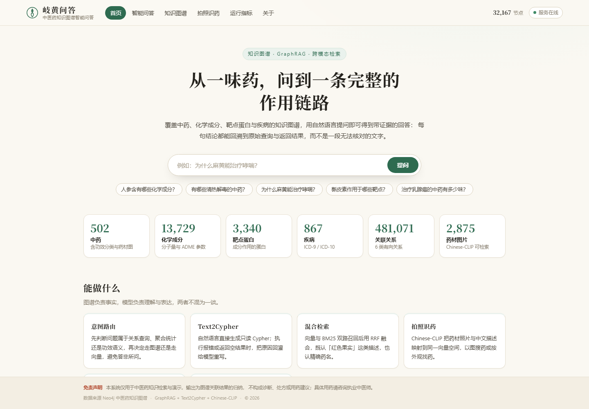
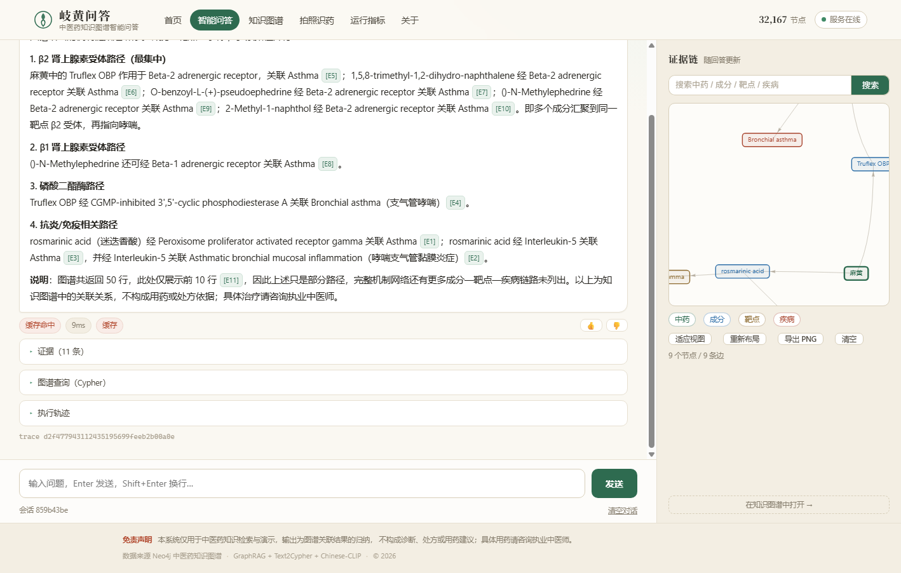
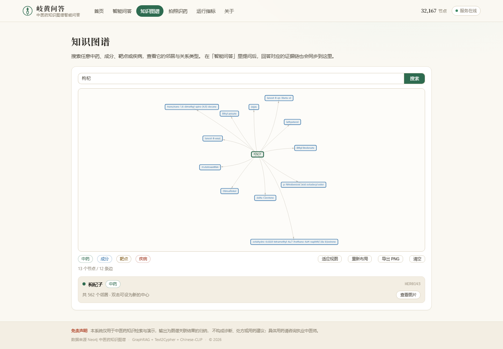
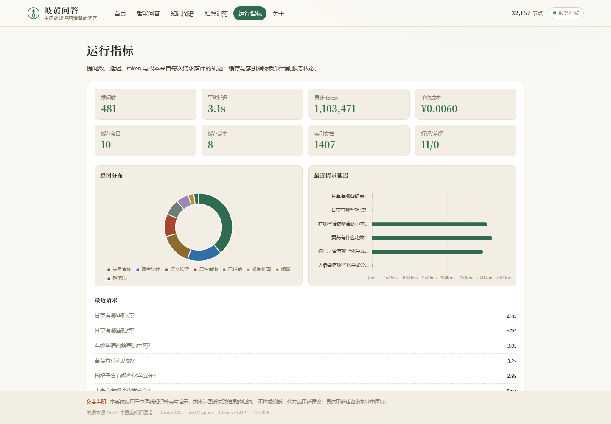
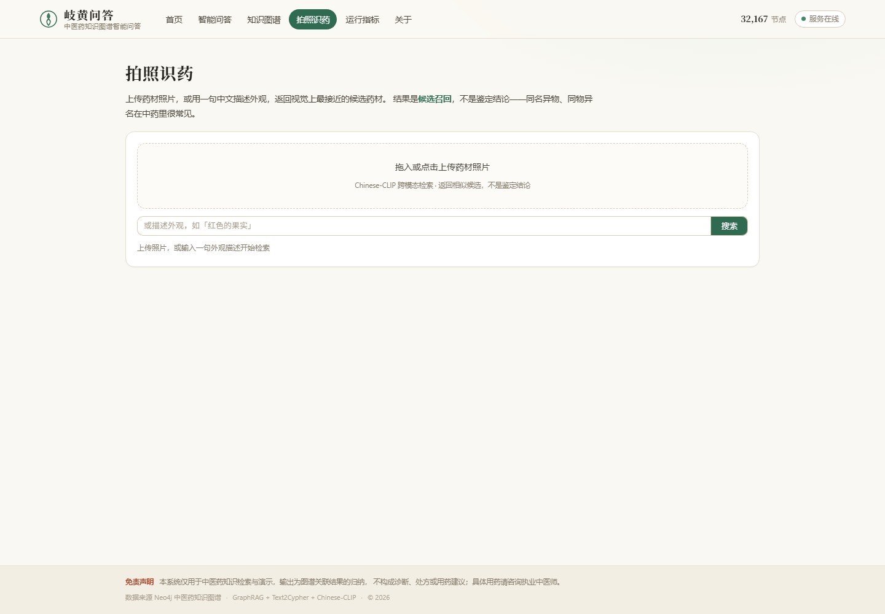

# 中医药知识图谱智能问答系统（GraphRAG）

基于 Neo4j 中医药知识图谱的问答系统：**意图路由 + 双路检索 + 证据约束生成**。
不是「把问题丢给大模型」，而是让模型去查一张 3.2 万节点、48 万条边的图，
再用查到的证据回答问题，每个结论都能追溯到具体证据和具体 Cypher。

```
用户问题 → 输入防护 → 缓存 → 规划(改写+路由+抽实体) → ┬─ Text2Cypher（含自修复）
                                                    └─ 向量 + BM25（RRF 融合）
       → 证据装配(E1..En) → 强制引用生成 → 引用校验 → 答案 + 证据 + 轨迹
```

## 界面

门户 + 工作台两段式：首页看图谱规模与能力，问答页左侧对话、右侧实时证据链。

| 首页 | 问答（右侧为证据链，vis-network 可拖拽缩放） |
| --- | --- |
|  |  |

| 知识图谱 | 运行指标 |
| --- | --- |
|  |  |

| 拍照识药 |
| --- |
|  |

界面用 Vue3 + Vite，支持 hash 路由（`#chat`、`#graph`…），
`#chat?q=问题` 可直接带着问题进入，`#graph?q=枸杞` 直接定位到某个实体。

图谱用 **vis-network**（力导向、拖拽、缩放、点击展开邻居），
指标页用 **ECharts**（意图分布环形图 + 最近请求延迟条形图），
交互细节用 **Element Plus**（按组件按需引入，主题改写成宣纸/竹青）。
三个库各自分 vendor chunk，非首页视图懒加载：ECharts 只在打开指标页时下载。

---

## 它能回答什么

| 问题类型 | 例子 | 走哪条路 |
| --- | --- | --- |
| 关系列举 | 人参含有哪些化学成分？ | Text2Cypher |
| 聚合统计 | 治疗乳腺癌的中药有多少味？ | Text2Cypher |
| 属性查询 | 槲皮素的分子量和 logP 是多少？ | Text2Cypher |
| 多跳机制 | 为什么麻黄能治疗哮喘？ | Text2Cypher（四跳链路） |
| 模糊语义 | 有哪些清热解毒的中药？ | 向量 + BM25 |
| 口语化 | 最近总睡不着，有什么中药能安神？ | 向量 + BM25 |
| 越界/闲聊 | 人参每天吃多少克？ | 直接拒答 + 引导 |

---

## 效果

数据来自 `python scripts/run_eval.py`，金标集 53 条（含 12 条难例），每次运行重新计算标准答案，
完整报告见 [评测报告](docs/eval_report.md) 与 [消融实验](docs/ablation.md)。

| 指标 | 数值 | 口径 |
| --- | --- | --- |
| 端到端通过率 | **100%**（53/53） | 自建金标集，含 12 条难例 |
| 意图路由准确率 | 100% | 规划器意图是否与标注一致 |
| 引用合法率 | 100% | 答案里的 `[En]` 都能在证据中找到 |
| 忠实度（LLM 评审） | 92.0% | 抽评 25 条，答案是否被证据支持 |
| 切题度（LLM 评审） | 0.71 / 1 | 仅统计「应该回答」的意图 |
| 延迟 | P50 **2.6s** / P95 4.3s | 单次问答含 3 次 LLM 调用 |
| 平均 token / 成本 | 2433 / **¥0.0064** | 按 DeepSeek 官方价估算 |
| 自修复触发率 | 1.9% | 需要二次生成 Cypher 的比例 |

**消融实验**（关掉某模块再跑，用差值衡量贡献）：

| 配置 | 通过率 | 差值 |
| --- | --- | --- |
| 完整系统 | 100.0% | — |
| 去掉向量检索 | 81.1% | **−18.9pp** |
| 去掉英文别名链接 | 96.2% | −3.8pp |
| 去掉自修复闭环 | 100.0% | 0 |

> **关于 100% 的说明**：这是在我自建的 53 条金标集上得到的，用例覆盖了系统设计的七类意图，
> 天然偏向能力圈，**不代表真实流量分布**。所以更有说服力的是消融数据——
> 它说明了向量检索和实体链接各自的具体贡献。也正因为如此，自修复在这个集合上
> 测不出收益（触发率 1.9%，关掉后通过率不变），我没有编造提升数字，详见 [消融实验](docs/ablation.md)。

---

## 为什么不是普通的向量 RAG

用户的问题一半是**精确关系**（人参含哪些成分），一半是**模糊语义**（手脚冰凉吃什么）：

- 纯向量 RAG：只能召回「人参的简介文档」，然后让模型根据「含有多种皂苷」去猜具体成分 —— 这就是幻觉来源；
- 纯 Text2Cypher：「手脚冰凉适合吃什么」没有可链接的实体，Cypher 无从下手。

所以做成两条路，由规划器在**一次 LLM 调用**里同时判断意图、改写指代、抽取实体，
再路由到对应检索器。两条路可以同时开（机制类问题就同时要图谱多跳链路和语义背景）。

---

## 架构

```
┌─────────────────────────────────────────────────────────────┐
│  前端（Vue3 + Vite） 流式对话 / 证据折叠 / 关系图可视化          │
└───────────────────────────┬─────────────────────────────────┘
                            │ HTTP + SSE
┌───────────────────────────▼─────────────────────────────────┐
│  FastAPI：/api/chat  /api/chat/stream  /api/graph  /api/metrics │
│  中间件：request_id · 访问日志 · LLM 并发闸门                   │
└───────────────────────────┬─────────────────────────────────┘
┌───────────────────────────▼─────────────────────────────────┐
│  RAG 编排                                                    │
│  guard → cache → planner → graph_retriever / semantic_retriever │
│                        → evidence → synthesize → verify         │
└──────────┬──────────────────────────┬───────────────────────┘
           │                          │
   ┌───────▼────────┐        ┌────────▼────────┐      ┌──────────┐
   │ Neo4j 32k/481k │        │ 向量索引 1407×512│      │ DeepSeek │
   └────────────────┘        │ + BM25          │      └──────────┘
                             └─────────────────┘
```

详细设计（含时序图、数据模型、选型权衡）见 [docs/architecture.md](docs/architecture.md)。

---

## 快速开始

### 1. 准备

- Python 3.10+
- Neo4j 5.x，且已导入中医药知识图谱（本仓库**不含原始数据**）
- DeepSeek API Key

### 2. 安装

```bash
pip install -r requirements.txt
cp .env.example .env      # 填入 DEEPSEEK_API_KEY 与 NEO4J_PASSWORD
```

### 3. 构建检索索引

```bash
python scripts/build_index.py          # 约 40 秒，产出 data/index/
```

> 首次运行会从 HuggingFace 下载 `bge-small-zh-v1.5`（约 95MB）。
> 国内网络建议在 `.env` 里设置 `HF_ENDPOINT=https://hf-mirror.com`。

疾病在图谱里是英文 ICD 术语，用户却习惯说「糖尿病」「哮喘」。仓库自带
`data/disease_zh.json`（867 条英文病名 → 中文译名，由 `scripts/translate_diseases.py`
用 LLM 批量生成），图搜索与语义检索都会用它做中英对齐——
中文病名既能被搜索框命中，也能被向量检索召回。若图谱新增了疾病，重跑该脚本即可增量补齐。

### 4. 启动

Windows 上推荐一键脚本（自动检查 Neo4j 与 API，缺什么起什么）：

```bat
start.bat              :: 或 .\start.ps1
start.bat -Restart     :: 先停再起
```

它会把两个进程各开一个最小化窗口，结束时打印健康检查结果。

手动启动：

```bash
# 1) Neo4j（Windows 下必须用 console；start 需要先把服务注册到系统）
D:\neo4j\neo4j-community-5.26.12-windows\neo4j-community-5.26.12\bin\neo4j.bat console

# 2) API
python -m uvicorn tcmqa.main:app --port 8000
```

### 前端（Vue3）

`frontend/` 是前端工程（Vue3 + Vite），项目不再保留旧版原生 JS 页面。

```bash
cd frontend
npm install
npm run dev       # http://localhost:5173 ，/api 与 /media 自动代理到 8000
npm run build     # 产出 frontend/dist，后端直接托管，重新构建后不需要重启 API
```

后端直接托管 `frontend/dist`（`StaticFiles` 每次请求读盘，**重新构建后不需要重启 API**）。
构建产物不进仓库，新环境需要先构建一次；
`start.bat` / `start.ps1` 检测到 `dist` 缺失时会自动安装依赖并构建。

结构：

```
frontend/src/
├── App.vue              视图切换（v-show 保活，对话状态不丢）
├── components/          TopBar 导航 / ChatPanel / AssistantMessage / Composer
│                        GraphTab 关系图 / VisionTab 拍照识药 / MetricsTab / AboutTab
│                        SidePanel 证据链侧栏 / Lightbox / CiteText
├── views/               HomeView 门户首页 / GraphPage / VisionPage / MetricsPage / AboutPage
├── stores/              ui.js（当前视图 + hash 路由）/ graph.js / lightbox.js
└── assets/style.css     宣纸色系设计变量与全部样式
```

### 5. 验证

```bash
python -m pytest tests -q        # 72 个单元测试
python scripts/test_api.py       # 39 项接口回归（需服务已启动）
python scripts/smoke_all.py      # 重启后的整体自检
python scripts/run_eval.py       # 金标集评测，产出报告
```

---

## 部署上线

线上展示的是**离线演示版**：把真实运行产生的问答录成静态数据，前端回放。
访客点开链接能看到完整界面、真实回答、真实证据与图谱，但不再调用模型——
因此不需要服务器、数据库和 GPU，纯静态托管即可。

```bash
# 1) 本机把服务跑起来，把真实问答录成 fixture
python scripts/export_demo_fixtures.py     # 16 条问答 + 首页统计 + 节点 + 识药结果
python scripts/fix_demo_nodes.py           # 统一节点命名 + 生成搜索索引
python scripts/export_demo_media.py        # 抽出被引用的图片（约 1.8 MB）

# 2) 构建静态包
cd frontend && npm run build:demo          # 产出 dist-demo/（约 3.4 MB）
```

把 `frontend/dist-demo` 发布到 **EdgeOne Pages** 即完成上线：
构建命令 `npm run build:demo`、输出目录 `dist-demo`。完整步骤见 [部署手册](docs/deploy.md)。

---

## 目录结构

```
tcmqa/
├── main.py              FastAPI 应用装配（lifespan / 中间件 / 静态资源）
├── settings.py          pydantic-settings 配置
├── logging.py           结构化 JSON 日志（request_id 用 contextvars 传递）
├── tracing.py           Span/Trace 模型，按阶段记录耗时与 token
├── guard.py             输入侧防护（注入 / 越权 / 医疗越界）
├── llm/
│   ├── client.py        DeepSeek 客户端（重试 / 流式 / usage 统计）
│   └── prompts.py       版本化 Prompt 模板
├── kg/
│   ├── client.py        Neo4j 只读访问（READ 模式 + 超时 + 行数截断）
│   ├── schema.py        Schema 描述（含实时规模，喂给模型）
│   ├── guard.py         Cypher 只读守卫（词法/结构/规模/执行四层）
│   └── linker.py        实体链接（精确→别名→子串→编辑距离）+ 功效识别
├── rag/
│   ├── corpus.py        图谱 → 自然语言语料
│   ├── embedder.py      bge-small-zh 封装
│   ├── vector_store.py  进程内向量索引（numpy）
│   ├── bm25_store.py    BM25 + RRF 融合
│   ├── retriever.py     混合检索器
│   ├── planner.py       改写 + 路由 + 实体抽取（一次调用）
│   ├── graph_retriever.py  Text2Cypher + 自修复闭环
│   ├── cache.py         精确缓存 + 语义缓存
│   └── pipeline.py      全链路编排（同步 + 流式）
├── api/                 路由与请求模型
├── store/sqlite.py      会话 / 轨迹 / 缓存 / 评测持久化
└── eval/                金标集、指标、执行器、报告渲染

frontend/                Vue3 + Vite 前端（src/components、stores、utils）
scripts/                 build_index · run_eval · test_api · smoke · 数据探查 · 演示数据导出
tests/                   pytest 单元测试
docs/                    架构设计 / 评测报告 / 部署手册
data/                    金标集、索引、SQLite
```

---

## 主要接口

| 方法 | 路径 | 说明 |
| --- | --- | --- |
| POST | `/api/chat` | 同步问答，返回答案 + 证据 + Cypher + 轨迹 |
| POST | `/api/chat/stream` | SSE 流式：`meta → plan → retrieval → evidence → token* → citations → done` |
| GET | `/api/graph/overview` | 图谱规模与 Top 榜 |
| GET | `/api/graph/node` | 节点详情 + 邻居 |
| POST | `/api/graph/cypher` | 手动执行只读 Cypher（同样过守卫，便于对比人手写和模型写） |
| GET | `/api/metrics` | 提问数、平均延迟、token、成本、意图分布、缓存命中 |
| GET | `/api/health` | Neo4j / LLM / 索引 / 缓存健康状态 |
| POST | `/api/feedback` | 👍👎 反馈 |
| GET | `/api/media/resolve` | 实体名批量转图片地址（中药封面 / 分子结构式） |
| GET | `/api/media/herb/{id}/images` | 某味中药的全部图片列表 |
| GET | `/api/media/herb/{id}/image/{idx}` | 中药原图（序号由服务端解析，不接受任意路径） |
| GET | `/api/media/stats` | 图片资源就绪情况 |
| POST | `/api/vision/search-image` | 上传药材照片 → 候选中药（Chinese-CLIP） |
| GET | `/api/vision/search-text` | 中文描述/药名 → 候选中药，支持 `alpha` 融合权重 |
| GET | `/api/vision/stats` | 图像索引状态 |

---

## 图片资源

图谱里两类实体带图，用起来的方式不一样：

| 来源 | 规模 | 处理方式 |
| --- | --- | --- |
| 中药 `image_path` | 502 味 / 2,876 张 / 1.13 GB | 预生成 480px webp 封面（18.7 MB）+ 200px 图库缩略图（21 MB） |
| 成分 `structure_image_path` | 13,728 张 / 168 MB | 体积只有 2~14 KB，**不转换**，静态目录直发原图 |

原图平均 200 KB、单张最大 1.6 MB，直接塞给前端会拖死首屏，所以做了尺寸分流：
**卡片缩略图 30 KB 级、图库条带 6 KB 级、点开放大才加载原图。**

```bash
python scripts/build_images.py     # 生成封面与缩略图，约 90 秒
```

界面上：
- 证据卡片左侧显示对应的中药照片 / 分子结构式
- 点击图片放大；中药通常有多张（平均 5.7 张，最多 58 张），底部有缩略条可切换
- 右栏搜索中药时显示该药的照片

原始图片目录不在仓库内，通过 `HERB_IMAGE_ROOT` / `MOL_IMAGE_ROOT` 环境变量配置；
目录缺失时接口降级为「无图」，不影响问答主流程。

## 多模态检索：拍照识药

用 Chinese-CLIP 把中药照片和中文描述映射到同一向量空间，支持两种入口：

- **以图搜药**：上传药材照片 → 最相似的候选中药（Top-5 命中率 **70.8%**，leave-one-out 评测）
- **以文搜图**：中文描述 → 最匹配的药材（如「红色的果实」→ 山茱萸 / 覆盆子 / 北五味子）

关键工程决策：**纯 CLIP 的文本塔对「药名」不敏感**（Top-5 仅 40%），
所以为每味药预计算「药名+功效」的文本向量，与图像分数加权融合。
α 扫描后取 0.5：**40.0% → 86.0%**，且比纯文本的 78.7% 还高 7.3pp，
说明图像项提供的是额外信息而非噪声。

```bash
python scripts/build_vision_index.py     # 2,875 张图，约 7 分钟
python scripts/build_vision_text.py      # 502 条药名文本，约 14 秒
python scripts/eval_vision.py            # 图搜图评测
python scripts/eval_vision_text.py --sweep   # 文搜图 + α 扫描
```

候选结果可以一键「追问这味药」，直接进入图谱问答——**图片只负责定位实体，
事实性回答仍由图谱提供**，保证结论可追溯。

完整分析见 [多模态检索](docs/multimodal.md)。

---

## 评测怎么做

`data/golden_set.jsonl` 每条用例定义「问什么、期望什么意图、怎么判对错」：

```json
{"id": "R01", "question": "人参含有哪些化学成分？", "intent": "relation",
 "mode": "set", "gold_label": "Ingredient",
 "gold_cypher": "MATCH (h:Herb {name:'人参'})-[:CONTAINS]->(i:Ingredient) RETURN DISTINCT i.name AS v",
 "threshold": 0.8}
```

四种判分模式：

- `set`：用 `gold_cypher` **现算**标准结果集，与系统返回做集合比对（不依赖列名，靠标签全集过滤）；
- `number`：现算标准数值，带容差比对；
- `hit`：语义检索题，检查期望文档是否被召回；
- `none`：判意图 / 关键词 / 是否被防护拦截。

三层指标：**路由准确率**（意图对不对）→ **执行准确率**（结果集对不对）→ **生成质量**（LLM 评审的忠实度与切题度），
外加延迟分位、token、成本、引用合法率。

支持消融实验，用差值衡量每个模块的贡献：

```bash
python scripts/run_eval.py --ablate vector    # 关掉向量检索
python scripts/run_eval.py --ablate aliases   # 关掉英文别名链接
python scripts/run_eval.py --ablate repair    # 关掉 Cypher 自修复
```

---

## 工程上的几个点

**只读守卫（四层）**：字符串字面量剥离后再做黑名单 → 结构校验（必须 MATCH 开头、必须 RETURN、禁分号禁注释）
→ 强制 LIMIT → 驱动层 `AccessMode.READ` + 查询超时。前几层是降低成本，最后才是真正的边界。

**Text2Cypher 自修复**：执行报错就把 Neo4j 原始报错回灌重写；执行成功但 0 行则提示
「多半是跨语言实体名不匹配」并允许放宽为 `CONTAINS`。

**混合检索用 RRF 而不是加权求和**：向量余弦 0~1、BM25 无上界，加权求和要归一化并调权重；
RRF 只用排名，`score = Σ 1/(60 + rank)`，换数据集不用重标定。

**语义缓存**：问题归一化后 sha256（精确）+ 问题向量余弦 ≥0.95（语义），
阈值偏高是刻意的——宁可多花一次调用，也不要因为「差不多」答错。

**可观测性**：每请求一条 Trace，按阶段开 Span，落 SQLite；`/api/metrics` 直接给出
「慢在哪个阶段、贵在哪个意图、缓存命中多少」。

**不上向量数据库**：1407 篇文档 × 512 维，numpy 暴力点积是毫秒级，引 FAISS/Milvus 只增加故障面。
选型跟着数据量走，换的时候只改 `vector_store.search`。

---

## 已知限制

1. 图谱只覆盖「药-成分-靶点-疾病」，没有方剂、配伍、证型，回答不了「四君子汤治什么」；
2. 1.3 万个成分未进向量索引（英文缩写名语义区分度差），只走图谱精确匹配；
3. 金标集 53 条，我自标注，覆盖了主要意图但不代表真实流量分布；
4. 单机 SQLite，不适合高并发写；
5. 回答是基于图谱的归纳，**不构成任何诊疗建议**。

---

## 文档

- [架构设计](docs/architecture.md) — 时序图、数据模型、每个选型的权衡
- [部署手册](docs/deploy.md) — 生成离线演示包并发布到 EdgeOne Pages
- [评测报告](docs/eval_report.md) — 最新一次全量评测
- [消融实验](docs/ablation.md) — 各模块贡献的量化分析
- [多模态检索](docs/multimodal.md) — Chinese-CLIP、α 扫描、leave-one-out 评测
