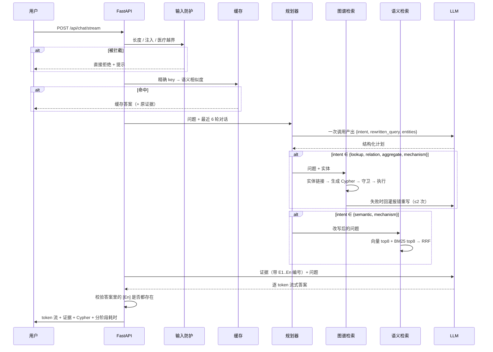
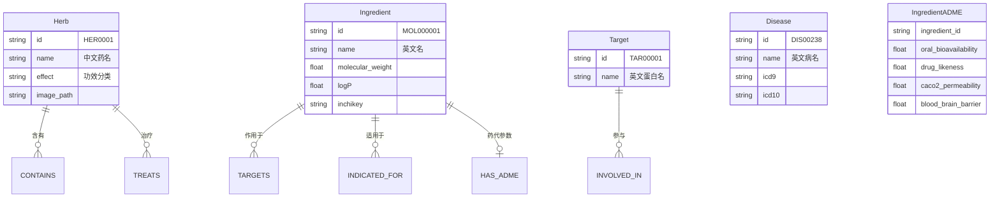
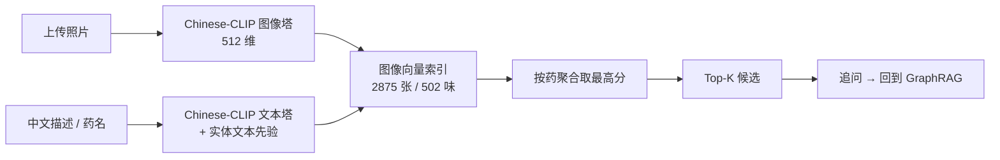

# 架构设计

## 1. 项目定位

一个**面向中医药知识图谱的问答系统**。它的核心问题不是「怎么调大模型」，而是：

> 当用户的问题一半是**精确关系**（人参含哪些成分、哪些药治糖尿病），
> 一半是**模糊语义**（手脚冰凉吃什么、清热解毒的药有哪些），
> 怎么能用同一套系统都答对，并且答得可验证？

纯向量 RAG 答不好前者——「人参含哪些成分」需要遍历图上的 `CONTAINS` 边，
向量检索只能召回「人参的简介文档」，然后让模型去编。
纯 Text2Cypher 也答不好后者——「手脚冰凉适合吃什么」没有可链接的实体，Cypher 无从下手。

所以本项目的答案是：**意图路由 + 双路检索 + 证据约束生成**。

## 2. 总体架构

```mermaid
flowchart TB
    subgraph 前端["前端（Vue3 + Vite）"]
        UI["对话界面<br/>流式渲染 / 证据折叠 / 关系图"]
    end

    subgraph API["API 层（FastAPI）"]
        R1["POST /api/chat"]
        R2["POST /api/chat/stream (SSE)"]
        R3["/api/graph/*"]
        R4["/api/metrics"]
        MW["中间件：request_id / 访问日志 / 并发闸门"]
    end

    subgraph 编排["RAG 编排层"]
        G["输入防护"]
        C["语义缓存"]
        P["规划器<br/>改写 + 路由 + 抽实体"]
        GR["图谱检索器<br/>Text2Cypher + 自修复"]
        VR["语义检索器<br/>向量 + BM25 + RRF"]
        S["答案合成<br/>强制引用"]
        V["引用校验"]
    end

    subgraph 存储["存储与外部服务"]
        N[("Neo4j<br/>32k 节点 / 48 万边")]
        SQ[("SQLite<br/>会话/轨迹/缓存/评测")]
        L["DeepSeek API"]
        E["bge-small-zh<br/>512 维向量"]
    end

    UI -->|HTTP / SSE| API
    MW --> R1 & R2 & R3 & R4
    R1 & R2 --> G --> C --> P
    P --> GR --> N
    P --> VR --> E
    VR -.索引.-> N
    GR & VR --> S --> V
    S --> L
    P --> L
    R1 & R2 --> SQ
    R3 --> N
    R4 --> SQ

    style 编排 fill:#1c2420,stroke:#4ade80
    style 存储 fill:#161d19,stroke:#2a3530
```



## 3. 一次问答的完整链路



## 4. 为什么这样分层

| 层次 | 职责 | 为什么独立 |
| --- | --- | --- |
| `tcmqa/kg` | 图访问、Schema、只读守卫、实体链接 | 图谱是外部依赖，要能单独替换/单测；只读守卫是安全边界，不能被上层绕过 |
| `tcmqa/rag` | 语料、索引、路由、自修复、合成 | 算法与编排都在这里，改检索策略不影响接口 |
| `tcmqa/llm` | 调用、重试、计费、Prompt 版本 | Prompt 集中管理才能做 A/B 和回溯 |
| `tcmqa/api` | HTTP、校验、SSE、并发控制 | 与业务解耦，方便换成 gRPC 或 CLI |
| `tcmqa/store` | SQLite 持久化 | 换成 PG 只改一个文件 |
| `tcmqa/eval` | 金标集、指标、评审 | 评测是独立能力，不嵌在业务代码里 |

## 5. 关键设计决策

### 5.1 意图路由用「一次 LLM 调用」而不是三次

朴素做法是串三个调用：改写 → 分类 → 抽实体。代价是 3 次往返（约 +1.5s）、3 次计费，
而且三次调用对「问题里提到了谁」可能给出不一致的答案，导致后面的 Cypher
用了实体 A、合成阶段却以为在讲实体 B。

合并成一个 `plan` 调用后，输出是一个 JSON：
`{intent, rewritten_query, entities[{text,type,aliases}], needs_graph, needs_vector}`。

**降级策略**：LLM 调用失败或返回非法 JSON 时，用一套正则规则判断意图（`_heuristic_intent`），
保证系统在模型侧故障时仍能走图谱检索，而不是整个挂掉。

### 5.2 实体链接必须做，否则跨语言查询必然失败

图谱里中药是中文（`人参`）、成分/靶点/疾病是英文（`quercetin` / `Asthma`）。
用户问「槲皮素作用于哪些靶点」，模型需要知道槲皮素 = `quercetin`。

三级链接（`kg/linker.py`）：

1. **精确/别名**：由规划器给出的 `aliases`（LLM 负责生成英文名）做大小写不敏感匹配；
2. **双向子串**：处理「人参」与「人参皂苷」这类包含关系；
3. **编辑距离**：`SequenceMatcher ≥ 0.82` 兜底错别字。

此外还有一层**功效分类识别**：`effect` 是属性值（如 `清热解毒药`）而非节点，
所以单独扫描类目表——这也是「哪些清热解毒的药」能路由到语义检索的关键信号。

### 5.3 Text2Cypher 的可靠性：Schema 描述比自修复更关键

这里有一个**实测出来的反直觉结论**。

我原本的预期是：单次生成会大量出错，靠「执行报错回灌重写」的闭环救回来。
但消融实验显示，在 Schema 描述充分的前提下（标签/属性/关系说明 + 常见问法的正确写法 +
数据规模提示 + 动态 few-shot），53 条金标集里自修复**只触发 1.9%**，
把它关掉后通过率**完全不变**；把提示词进一步削弱（去掉 few-shot、去掉「TREATS 边密集必须 DISTINCT」）
之后首次生成依然几乎全对。

也就是说：**真正决定效果的是 Schema 描述和示例质量，不是重试次数。**

闭环仍然保留，因为它覆盖的是金标集没覆盖的失败模式：

```
生成 → 守卫校验 → 执行 ─┬─ 成功且有数据 → 结束
                        ├─ 执行报错 ────→ 把 Neo4j 原始报错回灌，重写
                        └─ 成功但 0 行 ─→ 提示「多半是实体名不匹配」，放宽为 CONTAINS，重写
```

真实用户会问图谱里不存在的实体、会拼错药名、会遇到新收录的成分——
这些才是修复触发的场景，而它们天然不在金标集里。

**另一个实测发现**：关掉英文别名链接后，`姜黄素作用于哪些靶点` 这条会返回
**27 条结果而正确答案只有 5 条**——模糊匹配把「姜黄素」匹配到了若干个
`bisdemethoxycurcumin` 之类的衍生物。这比返回 0 行危险得多：0 行时模型会说「没找到」，
而错误匹配会产出一篇读起来很顺、结论错误的答案。所以实体链接必须
**精确优先、模糊仅兜底**，并且把匹配方式（精确/别名/近似）写进 prompt，
让模型对近似匹配的结果保持保守表达。

### 5.4 为什么用 RRF 融合而不是加权求和

向量的余弦分数（0~1）和 BM25 的分数（0~30+ 无上界）量纲完全不同，
加权求和需要调权重且不稳定。RRF 只用排名：

```
score(d) = Σ_i 1 / (k + rank_i(d)),  k = 60
```

好处是无参数标定、对分数分布不敏感、两路都排在前面的文档自然胜出。
而且以后加第三路（比如按热度）不用重新调权重。

### 5.5 为什么不上向量数据库

索引规模是 **1407 篇文档 × 512 维**。暴力点积在这个量级是**毫秒级**，
引 FAISS/Milvus 只会增加部署复杂度和故障面。选型跟着数据量走：

- 1 万级 → numpy 暴力检索（当前）
- 百万级 → HNSW（faiss / pgvector / Milvus）
- 需要过滤 + 多租户 → 带 payload 的向量库

换的时候只需要替换 `rag/vector_store.py` 的 `search`，其余代码不动。

### 5.6 缓存分两级

- **精确缓存**：问题归一化（去标点空格、小写）后 sha256，零成本；
- **语义缓存**：问题向量化，与历史问题比余弦，≥0.95 复用。

阈值取 0.95 是偏保守的选择：宁可多花一次模型调用，也不要因为「差不多」答错。
实测「人参有什么成分」与「人参含有哪些化学成分」相似度约 0.97 能命中，
而「人参的成分」与「黄芪的成分」在 0.85 左右不会误命中。

## 6. 数据模型



规模：`Herb 502 / Ingredient 13729 / Target 3340 / Disease 867 / IngredientADME 13729`，
关系 `INDICATED_FOR 248832 / TREATS 128779 / TARGETS 53727 / CONTAINS 33568 / HAS_ADME 13729 / INVOLVED_IN 2436`。

**数据上的坑**（做过的都知道，面试也爱问）：

- 疾病名是英文 ICD 术语，用户说「糖尿病」，图里是 `Diabetes mellitus`，
  且还有 `Noninsulin-dependent diabetes mellitus` 等多个近义节点 → 必须靠别名链接和 `CONTAINS` 放宽；
- `TREATS` 平均每味药 250+ 条边，不加 `DISTINCT` 会返回大量重复中药；
- `IngredientADME.half_life` 几乎全为空，`coalesce` / `OPTIONAL MATCH` 是必须的；
- 部分成分名是缩写（`FMT`、`IPA`、`GLY`），语义检索帮不上忙，只能靠精确匹配。

## 7. 语料构建（GraphRAG 的「R」）

语义检索需要文本，而图谱是三元组。`rag/corpus.py` 把图**投影**成自然语言：

| 文档类型 | 内容 | 支撑的问题 |
| --- | --- | --- |
| `herb` × 502 | 药名、功效分类、主要成分、可治疾病 | 「人参是什么药」 |
| `effect` × 38 | 功效类目、该类数量、代表药材 | 「清热解毒的药有哪些」 |
| `disease` × 867 | 病名（中英）、ICD、相关中药与靶点 | 「哮喘能用什么中药」 |

**关键点**：语料不是凭空生成的，全部由 `MATCH` 聚合而来，
所以向量检索命中的内容天然与图谱一致，不存在「检索说一套、图谱说一套」。

疾病名是英文 ICD 术语，中文提问（「银屑病」）召回不到，所以留了一个可选的增强：
`scripts/translate_diseases.py` 用 LLM 批量生成 867 个病名的中文译名到
`data/disease_zh.json`，重新建索引后生效。**本仓库默认没有生成该文件**——
中文病名目前由图谱分支的别名链接兜住，效果见金标集 H06（银屑病）用例。

## 8. 多模态分支（拍照识药）

图谱里两类实体带图，除了「显示」之外还做了一条独立的检索分支：



三个关键决策，都有实测支撑：

1. **每味药索引多张照片**，检索时按药聚合取最高分。
   一味药的照片横跨原植物、饮片、粉末，只用封面代表会大量漏召。
2. **索引里放 200px 缩略图的向量**，不是 1.13GB 原图。
   CLIP 反正要缩到 224×224，用缩略图编码结果几乎一样，读盘快几十倍，索引只有 5.9MB。
3. **文本查询加实体先验**：纯 CLIP 文本塔对药名不敏感（Top-5 40%），
   给每味药预存「药名+功效」文本向量后加权融合，α=0.5 时 Top-5 到 86.0%。

边界很明确：**视觉只负责定位实体，事实性回答仍由图谱提供**，
所以多模态输出同样可被证据追溯，不会出现「模型看图编药效」。

完整分析（含 α 扫描与 leave-one-out 评测）见 [多模态检索](multimodal.md)。

## 9. 可观测性

每次请求生成一条 `Trace`，每个阶段一个 `Span`：

```
plan 812ms → cypher_generate 754ms → synthesize 1936ms
输入 2400 tokens / 输出 550 tokens / 估算 ¥0.0081
```

落 SQLite 后可以回答：慢在哪个阶段、哪个意图最贵、失败率最高的环节、
缓存命中率、用户点踩是否集中在某个意图。`/api/metrics` 直接吐出这些聚合值。

## 10. 部署

- **本地**：`run.ps1 serve`（Windows）或 `uvicorn tcmqa.main:app`
- **容器**：`docker-compose up`（Neo4j + API，图谱数据需自行导入）
- **健康检查**：`GET /api/health` 返回 Neo4j 连通性、索引文档数、LLM key 状态

## 11. 已知限制

诚实列出，比藏起来强：

1. 语料只覆盖中药/功效/疾病三类，1.3 万个成分没有进向量索引——
   英文缩写名（`FMT`）语义检索效果差，走图谱精确匹配更靠谱；
2. 语义缓存在问题改写较大时会漏命中，阈值的取舍是「宁可不命中」；
3. 单机 SQLite 不适合高并发写，上量需要换 PG；
4. 答案是「基于图谱的归纳」，不等于临床结论。
